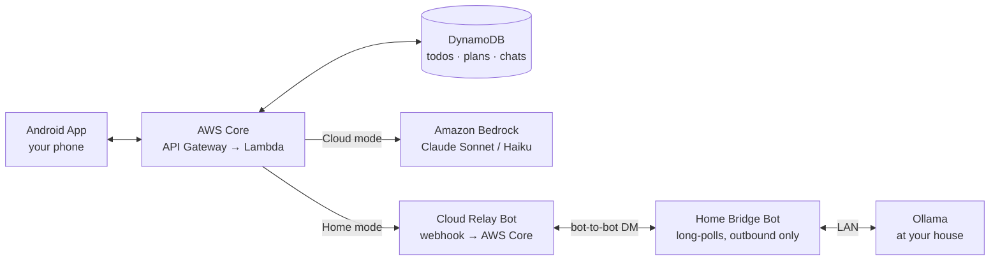
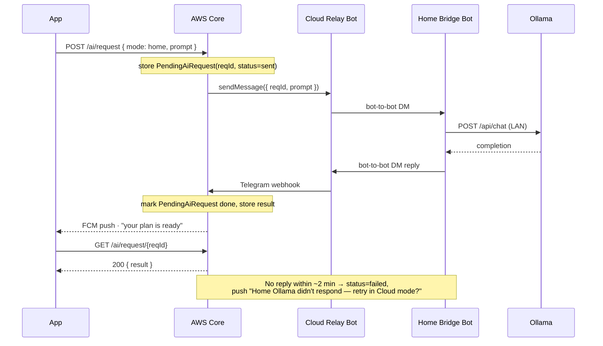
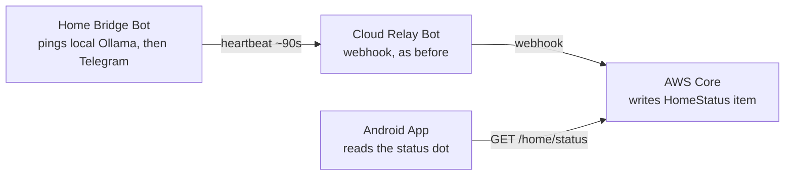

# Structure — Architecture

A cloud-first todo app: an Android client backed by an AWS API, with two
interchangeable AI engines behind one interface — Bedrock in the cloud, or
your own Ollama model at home, bridged in over Telegram so nothing at your
house needs an open port.

> This file is the living copy — edit it as the design changes. The v2
> review snapshot also exists as a [published page](../README.md) and a
> Word document, but this file is what stays current with the code.

## Contents

1. [At a glance](#01--at-a-glance)
2. [System architecture](#02--system-architecture)
3. [AI routing](#03--ai-routing)
4. [The Telegram ⇄ Ollama bridge](#04--the-telegram--ollama-bridge)
5. [AWS backend](#05--aws-backend)
6. [Data model](#06--data-model)
7. [AI features](#07--ai-features)
8. [Android app](#08--android-app)
9. [Security & assumptions](#09--security--assumptions)
10. [Open questions](#10--open-questions)
11. [Roadmap](#11--roadmap)

---

## 01 — At a glance

Four things came out of the last round of review, and everything below is built on them:

| | |
|---|---|
| **AI routing** | A single Settings switch — Cloud (Bedrock) or Home (Ollama via Telegram) — not an automatic per-message hybrid. Whichever you pick answers every plan and every chat message until you flip it back. |
| **Cloud AI engine** | Amazon Bedrock, calling Claude models directly — no servers to patch, cost scales to zero when idle. |
| **System of record** | Cloud-first. The AWS backend owns your todos. The app and the Telegram bridge are both clients of the same API, so a todo added from either place shows up in both. |
| **Ollama model** | Start around 8B (Qwen2.5 or Llama 3.1 8B-instruct) and scale up later — the Home Bridge Bot reads the model tag from local config, so growing it is a config change on the home box, not an app or infra change. |
| **Reminders** | Due-date notifications and recurring todos are v1, not a phase-4 nicety — folded into Phases 0–1. |

## 02 — System architecture

The app never talks to Bedrock or to Ollama directly. Everything goes through
one AWS API, which is the only thing that knows which mode you're in. That
keeps the phone simple and means switching modes is a server-side flag flip,
not an app update.

The trick that makes Home mode possible without opening a port at your house,
running a VPN, or paying for a tunnel service: Telegram supports **direct
bot-to-bot messaging** (rolled out May 2026), so two bots you own can DM each
other once each enables it in BotFather. Your home machine only ever makes
*outbound* connections — it long-polls its own bot for messages, same as it
always could.

## 03 — AI routing

You asked for this as a plain toggle rather than an automatic hybrid, so
that's the contract: whatever mode is set in Settings answers *every* plan
generation and *every* chat turn, until you change it. No silent fallback
from Home to Cloud mid-conversation — if your home machine or Ollama is
down, the request fails with a clear error and a one-tap "switch to Cloud
and retry," rather than quietly spending Bedrock tokens you didn't ask for.

| Trait | Cloud mode | Home mode |
|---|---|---|
| Model | Claude on Bedrock (Sonnet 4.6 / Haiku 4.5) | Qwen2.5 or Llama 3.1, starting at 8B |
| Typical latency | 1–4s | 5–30s+ (Telegram hop + your hardware) |
| Cost | Per-token, pay as you go | Electricity only |
| Available | Anywhere with signal | Only while the home machine is on and reachable by Telegram — see §04 |
| Output reliability | High — strong structured-output support | Model-dependent; needs a stricter parser, see §07 |

> **Design note** — both paths implement the same `AiEngine` contract
> (system prompt + message list + a JSON output schema in → structured
> result out), so the app, the prompt library, and the plan-rendering UI
> never need to know which engine answered. That's what keeps the door
> open to a future opt-in "auto" mode later, without it being the default now.

## 04 — The Telegram ⇄ Ollama bridge

The one genuinely novel piece of the system.

### Why Telegram at all

Your Ollama box has no public IP and shouldn't get one. Telegram's servers
already hold a persistent connection to your home bot and to a bot running
in AWS, and relay messages between them — NAT traversal, encryption in
transit, and a delivery queue for free, in exchange for trusting Telegram as
the transport. No port forwarding, no Tailscale/VPN box, no tunnel bill.

### Two bots, not one

| Bot | Runs | Token lives | Role |
|---|---|---|---|
| **Cloud Relay Bot** | AWS Lambda, via a Telegram webhook | Secrets Manager | Turns an AWS-side AI request into a Telegram DM to the Home Bridge Bot; turns the reply back into an API result |
| **Home Bridge Bot** | Small always-on process at your house | Local env file, never leaves your network | Long-polls for prompts, calls local Ollama, DMs the answer back |

Both enable `Bot-to-Bot Communication Mode` in BotFather, which is what lets
them DM each other directly under Telegram's May 2026 bot-to-bot feature —
previously this needed a shared-group workaround. The Cloud Relay Bot runs
as a webhook (Telegram pushes to API Gateway); the Home Bridge Bot keeps
doing what home bots have always done — long-poll outbound, no inbound port.

### The round trip is asynchronous

A Bedrock call answers in a few seconds; a request that has to reach your
house, run on local hardware, and come back can take much longer — and the
home machine might just be off. Home-mode requests are fire-and-collect,
not request/response:

### Knowing whether Home is actually up

Requested without adding new infrastructure — and it fits, because the Home
Bridge Bot already has a live connection to Telegram, so it just sends a
second, lighter kind of message down the same pipe.

| Step | What happens |
|---|---|
| Heartbeat | Every ~90s, the Home Bridge Bot checks local Ollama (a cheap `/api/tags` call) and DMs the Cloud Relay Bot a small status message — online/offline, which model is loaded. |
| Record | The same webhook Lambda tells this message type apart from an AI reply and upserts a `HomeStatus` item — one record, overwritten in place, not a growing log. |
| Read | The app calls `GET /home/status` — a plain DynamoDB read, no Telegram round trip — and shows online if the last heartbeat is recent, stale/offline otherwise. |

> **No infrastructure change** — this reuses the exact services in §05: the
> same webhook Lambda, the same DynamoDB table, the same two bots. One more
> item shape, one more thin API route — nothing new to provision.

### Practical limits worth knowing now

- **Message size.** Telegram caps a text message around 4,096 characters. A
  prompt carrying a week's worth of todos plus conversation history can
  exceed that, so the relay sends compact JSON (todo IDs + short titles, not
  full descriptions) and chunks long payloads with a sequence header the
  Home Bridge Bot reassembles before calling Ollama.
- **No inbound exposure, either direction.** Neither bot ever needs an open
  port at your house. The Home Bridge Bot's only network requirement is
  outbound HTTPS to Telegram and a local call to Ollama.
- **Loop prevention.** Telegram's own bot-to-bot docs call this out
  explicitly — every relayed message carries the `reqId`, both bots ignore
  anything without one, and the Home Bridge Bot rate-limits itself so a
  stuck retry loop can't hammer your GPU.

## 05 — AWS backend

Nothing here needs to run 24/7 except the thin webhook handler, which is
itself just a Lambda — so at single-user scale, most months this should
cost very little beyond Bedrock token usage. The whole stack is defined in
code (AWS CDK, TypeScript) rather than clicked together.

| Service | Role |
|---|---|
| API Gateway (HTTP API) | Public entry point for the Android app and the Telegram webhook |
| Lambda | Todo CRUD, plan/chat orchestration, Telegram webhook handler — one function per concern |
| DynamoDB | Single table, on-demand capacity: todos, plans, conversations, pending AI requests |
| Cognito | Sign-in for the app; issues the tokens API Gateway checks on every call |
| Bedrock | Cloud-mode model calls |
| Secrets Manager | Cloud Relay Bot token, Telegram webhook secret |
| SNS → FCM | Push notifications: AI result ready, todo changed elsewhere, due-date & recurrence reminders |
| EventBridge Scheduler | New for v1 — scans for todos coming due, fires the reminder Lambda |
| CDK (TypeScript) | Everything above, as versioned infrastructure |

Reminders are the one place this round adds real infrastructure: a
scheduled scan (EventBridge → Lambda) rather than relying on the phone to
be open and running. Presence detection in §04, by contrast, adds no new
service at all.

### DynamoDB shape (single table)

| Item | PK | SK | Notes |
|---|---|---|---|
| Todo | `USER#id` | `TODO#id` | GSI on due date + status for "what's due this week" |
| Plan | `USER#id` | `PLAN#scope#periodStart` | scope = day / week / month / year |
| Conversation | `USER#id` | `CONVO#id` | Messages as an ordered list on the item, or overflowed past a size threshold |
| PendingAiRequest | `USER#id` | `REQ#id` | TTL-expired automatically; status: sent → done / failed |
| HomeStatus | `USER#id` | `HOME#status` | Single overwritten item: lastHeartbeatAt, model, ollamaOk |

Every Lambda gets its own least-privilege IAM role (the webhook handler can
write `PendingAiRequest` items and nothing else; only the orchestration
function can call Bedrock). API Gateway sits behind a Cognito authorizer and
a usage plan with rate limiting — it's a single-user app, but it's still a
public URL.

## 06 — Data model

| Entity | Key fields |
|---|---|
| **Todo** | title, notes, status, priority, dueDate, reminderAt, recurrenceRule?, project, tags[], source (app/telegram/ai), createdAt, updatedAt, completedAt? (server-derived — stamped on the status→done transition, cleared on reopening; see shared/types.ts) |
| **Plan** | scope (day/week/month/year), periodStart/End, summary, items[] → todoId + rationale, engine (cloud/home), generatedAt |
| **Conversation** | subjectType (plan/todo/general), subjectId?, messages[] → role, text, engine, ts |
| **PendingAiRequest** | reqId, kind (plan/chat), status, resultRef, createdAt, ttl |
| **HomeStatus** | lastHeartbeatAt, model, ollamaOk |

`source` and `engine` are small fields with outsized value: they're what let
the UI show "added from Telegram" or "planned by your home model" without
extra plumbing later.

> **Recurrence model** — a recurring todo is a small template (title,
> `recurrenceRule` as an iCal-style RRULE subset — daily/weekly/monthly/yearly
> with an interval) that materializes the next occurrence as its own
> concrete `Todo` item when the current one is completed or passes its due
> date. Each occurrence is independently completable and reschedulable, and
> history isn't lost when the series moves on.

## 07 — AI features

**Plan generation.** You pick a scope — day, week, month, year — and
optionally a focus ("prioritize the client work"). The orchestrator
assembles context: open todos in range, anything overdue carried forward,
and (for month/year) a lighter-weight summary rather than every individual
item. The model returns a strict JSON shape — an ordered agenda with a short
rationale per item — which the app renders as a real plan view.

**Dialog.** A chat grounded in either one todo, one generated plan, or "just
my todos in general," with history kept per conversation and summarized
once it gets long enough to threaten the context window.

**Cloud vs. Home reliability.** Claude on Bedrock follows a JSON schema
reliably. A local model under Ollama — starting at 8B, with headroom to move
to a 70B-class model on the same box later — is more variable at strict
structured output, and that variability tends to grow with plan complexity
before it shrinks with a bigger model. The orchestrator validates every
response against the schema and, on the Home path only, retries once with a
stricter "reply with JSON only" instruction before falling back to plain text.

## 08 — Android app

*Phase 1 status: built and running against the real deployed API — auth,
offline sync, and push notifications all confirmed working end to end,
including a real on-device push test — see `aws-backend/README.md`'s
"Push notifications" section for the registration-timing bug that
surfaced (and was fixed) getting there.*

| Layer | Choice |
|---|---|
| UI | Kotlin, Jetpack Compose, Material 3 |
| Architecture | MVVM + a small clean-architecture split (data / remote+local / ui) |
| DI | Manual (`AppContainer.kt`), not Hilt — see `android-app/README.md` ("Why manual DI instead of Hilt") for why this diverged from the original plan below |
| Networking | Retrofit + OkHttp + kotlinx.serialization (REST), Firebase Cloud Messaging for push |
| Auth | AWS Mobile SDK's Cognito Identity Provider client (real SRP), not Amplify |
| Local cache | Room — an offline queue and read cache in front of the cloud-first API, not a second source of truth |
| Background work | WorkManager — sync retries, queued offline edits |
| Settings | `ui/settings/`, AI mode persisted via Preferences DataStore (`data/local/AiModeStore.kt`) — see below |

**Screens built in Phase 1:** Login (Cognito SRP) · Todo list (complete,
delete, sync-pending indicator) · Todo detail (create/edit — title, notes,
project, priority, due date, reminder, recurrence).

**Phase 2 frontend — confirmed working end to end** (Planner + Dialog,
against the real deployed API and Bedrock): Planner (scope picker for
day/week/month/year, optional focus text, generated summary + agenda
tapping through to each todo) and Dialog (a chat screen grounded in a
single todo, a generated plan, or general "no specific subject" —
reachable from a "Chat" icon on the todo list, an "Ask AI about this"
icon on Todo detail, and a "Discuss this plan" button after generating a
plan). A bottom navigation bar (Todos / Plan) hosts the Planner tab; Todo
detail and Dialog are pushed on top of whichever tab is active rather than
being tabs themselves. Deliberately **not** part of this pass, unlike
Todo: these two screens carry no Room cache — a plan or a chat reply is a
live Bedrock call, not offline-first data (see §07) — so a network
failure surfaces as an inline error instead of silently retrying later.
Getting this working end to end also surfaced (and fixed) two real bugs
outside the Android code itself — see `android-app/README.md`'s and
`aws-backend/README.md`'s "About verification" / "AI planning & dialog"
sections: a kotlinx.serialization default-value encoding gap that was
silently dropping the request's `kind` field, and a missing AWS
Marketplace IAM permission (`aws-marketplace:ViewSubscriptions`/
`Subscribe`) on the orchestrator Lambda's role, separate from the
`bedrock:InvokeModel`/`Converse` grants it already had.

**Settings screen — confirmed built and working** (`ui/settings/`):
account (signed-in username, sign out), an AI mode row showing Cloud as
the active mode with Home visibly present but disabled (not a live toggle
— there's only one working mode until Phase 3), and placeholder rows for
Home Ollama status / Telegram link, both "Not available yet." This screen
reads `AuthRepository`/`CognitoAuthManager` directly for the account row.
The AI mode row is now backed by real Preferences DataStore
(`data/local/AiModeStore.kt`, `model/AiMode.kt`) rather than a hardcoded
literal — `AiRepository` reads the persisted mode on every request instead
of hardcoding `"cloud"` — but this is groundwork, not a live feature: the
Home chip stays `enabled = false` and nothing reachable from the UI can
write `AiMode.HOME`, so every real request still ends up built with
`AiMode.CLOUD` exactly as before. Deliberately built ahead of Phase 3 so
enabling the toggle later is a `SettingsScreen`-only change (flip
`enabled`, wire `onClick` to the already-existing `SettingsViewModel.setMode`)
rather than new storage/repository plumbing under time pressure.

**Still not built:** list filters for today/week/month/year and
project/tag chips on the todo list. The Settings screen's Home Ollama
status dot / Telegram link status are visible now but inert — they go
live once Phase 3's Telegram bridge + home-bridge-bot exist to answer for
them.

Reminders arrive as server-sent pushes from the EventBridge scan in §05,
rendered as ordinary system notifications — the phone doesn't need its own
alarm scheduling, and a reminder still fires if the app's been closed for
a week. The server side of push (an SNS platform application + a
per-device platform endpoint, subscribed to the reminder topic from the
device's FCM token via `POST /device/token`) now exists in `aws-backend`
— see `android-app/README.md`, "What doesn't work end-to-end yet," and
`aws-backend/README.md`'s "Push notifications" section for the one manual
Secrets Manager step still required before it deploys. A real
registration-timing bug (device registration only ever attempted once, at
first install, often before sign-in — see `TodoRepository.refreshDeviceTokenRegistration`'s
doc comment) was found and fixed while wiring this up. The Android app's
receiving side works and is independently testable via the Firebase
console even without any of the above deployed.

## 09 — Security & assumptions

Calls made in service of "architecture only, no code yet" that are worth
flagging rather than burying:

- Auth via Cognito even for a single-user app — more setup now, but it's
  what device-linking, token refresh, and any future second user all assume.
- All secrets (bot tokens, webhook secret) in Secrets Manager, never in the
  app or in source.
- API Gateway is public but rate-limited and authorizer-gated; nothing at
  your house ever accepts inbound connections.
- TLS everywhere; DynamoDB encryption at rest (default); each Lambda scoped
  to only the table keys and services it needs.

## 10 — Open questions

Home hardware, reminders/recurrence, and data import were resolved in the
v2 review and are folded into the sections above. One remains:

- **AWS account** — deploying Phase 0 needs an AWS account with billing set
  up and Bedrock model access requested for the Claude models in the target
  region.

## 11 — Roadmap

Each phase produces something that runs, so the design can course-correct
before the next one starts.

0. **AWS foundation** — CDK skeleton, Cognito, DynamoDB table (including
   recurrence/reminder fields), Todo CRUD API, EventBridge reminder scan.
   No AI, no app yet — a working, deployed, authenticated API, that already
   knows how to remind you about something. *Written, not yet deployed or
   verified by an actual build — see
   [`aws-backend/README.md`](../aws-backend/README.md#about-verification).*
1. **Android app skeleton** — auth, todo list + detail with recurrence &
   reminder picker, FCM push handling, wired to the real API with a
   Room-backed offline queue. A genuinely usable todo app, no AI yet.
   *Built and running end to end.*
2. **Cloud AI** — Bedrock integration: plan generation for all four scopes,
   and the Dialog screen. Cloud mode only — Home mode's toggle is visible in
   Settings but disabled (see §08); a "coming in phase 3" note there
   instead. *Deployed and confirmed working end to end — backend
   (`aws-backend/lambdas/ai-orchestrator/`, `POST /ai/request` + `GET
   /ai/request/{reqId}`) and the Android Planner/Dialog screens (§08) both.
   Two real bugs surfaced and were fixed getting here — see that lambda's
   README and `android-app/README.md`'s "About verification" for both.*
3. **Telegram bridge** — Cloud Relay Bot + webhook, Home Bridge Bot + Ollama
   integration (8B model to start), heartbeat presence, async request/push
   flow, Home mode enabled. The centerpiece from §04, end to end.
   *AWS backend half written, not yet deployed or tested* —
   `ai-orchestrator`'s Home-mode dispatch, `telegram-webhook`, `home-status`,
   `ai-request-timeout`, and `infra/lib/telegram-stack.ts`; see
   [`aws-backend/README.md`](../aws-backend/README.md#telegram-bridge-phase-3)
   for the manual BotFather/Secrets Manager setup this needs before it can
   even deploy. *The Home Bridge Bot itself — the process that would
   actually run at your house — is deliberately not built yet*: nothing
   here can complete a Home-mode request end to end until it exists, which
   is intentionally the next round of work, not this one.
4. **Polish** — widgets, offline conflict resolution, upgrading the home
   model past 8B, and whatever phase 1–3 usage surfaces as actually annoying.
